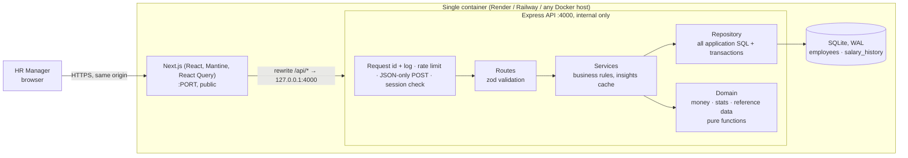
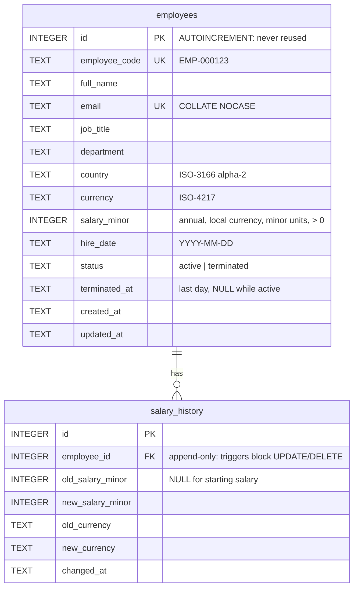

# Architecture

## Overview



**Why this shape:** the browser only ever sees one origin, so there's no CORS in practice and the API is not internet-facing. Each layer has one job. The repository is the only application code that knows SQL or the database library (enforced by `architecture.test.ts`), so a move to Postgres rewrites the repository, migrations and seed loader, while services and routes stay as they are.

## Request flow (example: edit a salary)
1. The form validates on the client for fast feedback, then sends `PATCH /api/employees/:id`. Middleware assigns a request id, applies the rate limit and checks the session cookie (401 → the UI redirects to sign-in).
2. The route parses the body with `employeeUpdateSchema` (zod). Invalid input becomes a `400` with field-level `details`, which the form maps back onto its inputs.
3. The service runs inside `repo.transaction()` (a `BEGIN IMMEDIATE` transaction), loads the current row and updates it. If salary or currency changed, it inserts a `salary_history` row in the **same transaction**.
4. Triggers bump the data version (clearing the server's insights cache) and refresh the search index. React Query invalidates its cached lists, insights and detail, so the drawer timeline shows the change immediately.

## Data model



Indexes: `country`, `department`, `job_title`, `full_name`, `(status, full_name)` for the default directory page, the composite `(country, job_title, salary_minor)` for pay-group queries, and `(employee_id, changed_at)` on history.

**Migrations** are ordered and recorded in SQLite's `user_version` (`db/database.ts`): 1 initial schema · 2 employee status · 3 triggers that make history append-only and block employee deletes · 4 the `(status, full_name)` index · 5 `app_meta.data_version` + triggers (insights cache) · 6 the USD salary-sort expression index · 7 the FTS5 trigram search index + sync triggers.

**Reference data** (countries, currencies with static FX rates, departments → job titles → level bands) lives in `apps/api/src/domain/reference.ts`. It changes when the code is released, not when HR edits data. It is the single source for validation enums, the seed and the UI dropdowns (served at `GET /api/meta`).

## API

| Method | Path | Purpose |
|---|---|---|
| GET | `/api/employees?page&pageSize&search&country&department&jobTitle&status&sortBy&sortDir` | Paginated directory (pageSize ≤ 100; sort fields allow-listed; `status` = active (default) / terminated / all) |
| GET | `/api/employees/:id` | Employee + salary history |
| POST | `/api/employees` | Create (201 + Location) |
| PATCH | `/api/employees/:id` | Partial update; salary/currency change writes history |
| POST | `/api/employees/:id/terminate` | Record that someone left (`{terminationDate?}`, defaults to today); record and history kept |
| POST | `/api/employees/:id/reinstate` | Undo a termination |
| DELETE | `/api/employees/:id` | 405: employees are never hard-deleted |
| GET | `/api/insights/summary?country&department&jobTitle` | Current employees: headcount, USD payroll, median; breakdown by country and department |
| GET | `/api/insights/pay-bands?…` | min/p25/median/p75/max per (country, job title), local currency + USD median |
| GET | `/api/insights/outliers?…&threshold&minGroupSize&limit` | Employees ≥ threshold away from their pay-group median |
| GET | `/api/meta` | Reference data for dropdowns, FX "as of" date |
| GET | `/api/health` | Liveness (public, not rate limited) |
| POST | `/api/auth/login` | Sign in (`{email, password}`); sets the session cookie; failed attempts rate limited |
| POST | `/api/auth/logout` | Clear the session |
| GET | `/api/auth/me` | The signed-in user |
| GET | `/api/auth/demo` | Demo deployments only: the demo credentials (404 otherwise) |

Every route except health and `/api/auth/*` requires a session (401 otherwise). Every POST must be `application/json` (415 otherwise). Every response carries `X-Request-Id`.

Errors always look like `{ "error": { "code", "message", "details?" } }` (500s add `requestId`). Stack traces and request bodies are never returned or logged.

## Repository layout

```
apps/
  api/src/
    domain/        reference data, money (FX), stats (percentiles): pure + unit-tested
    employees/     schemas (zod) · repository (SQL) · service (rules) · routes (HTTP)
    insights/      schemas · service · routes
    seed/          seeded PRNG · name pools · generator · transactional seed · CLI
    db/            connection pragmas · versioned migrations · online backups
    auth/          password hashing · signed sessions · sign-in routes and guards
    http/          error types/handler · request id + JSON logging
    app.ts         Express wiring (helmet, CORS, JSON limit)
    server.ts      boot: config → db → seed-if-empty → listen
  web/src/
    app/           Next.js routes: /login, / (directory), /insights
    components/    Shell, FilterBar, EmployeeForm, EmployeeDrawer
    lib/           typed API client, formatting, hooks
docs/              requirements, decisions, architecture, performance, AI usage, demo script
```
