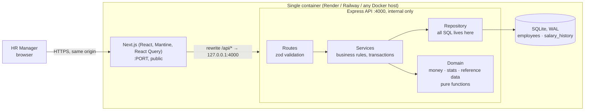
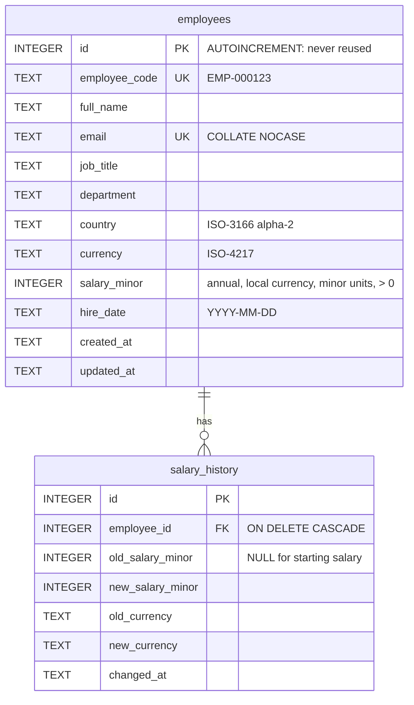

# Architecture

## Overview



**Why this shape:** the browser only ever sees one origin, so there's no CORS in practice and the API is not internet-facing. Each layer has one job, and the only layer that knows SQL is the repository, so a move to Postgres changes one folder.

## Request flow (example: edit a salary)
1. The form validates on the client for fast feedback, then sends `PATCH /api/employees/:id`.
2. The route parses the body with `employeeUpdateSchema` (zod). Invalid input becomes a `400` with field-level `details`, which the form maps back onto its inputs.
3. The service opens a `BEGIN IMMEDIATE` transaction, loads the current row and updates it. If salary or currency changed, it inserts a `salary_history` row in the **same transaction**.
4. React Query invalidates its cached lists, insights and detail, so the drawer timeline shows the change immediately.

## Data model



Indexes: `country`, `department`, `job_title`, `full_name`, the composite `(country, job_title, salary_minor)` for pay-group queries, and `(employee_id, changed_at)` on history.

**Reference data** (countries, currencies with static FX rates, departments → job titles → level bands) lives in `apps/api/src/domain/reference.ts`. It changes when the code is released, not when HR edits data. It is the single source for validation enums, the seed and the UI dropdowns (served at `GET /api/meta`).

## API

| Method | Path | Purpose |
|---|---|---|
| GET | `/api/employees?page&pageSize&search&country&department&jobTitle&sortBy&sortDir` | Paginated directory (pageSize ≤ 100; sort fields allow-listed) |
| GET | `/api/employees/:id` | Employee + salary history |
| POST | `/api/employees` | Create (201 + Location) |
| PATCH | `/api/employees/:id` | Partial update; salary/currency change writes history |
| DELETE | `/api/employees/:id` | Delete (204) |
| GET | `/api/insights/summary?country&department&jobTitle` | Headcount, USD payroll, median; breakdown by country and department |
| GET | `/api/insights/pay-bands?…` | min/p25/median/p75/max per (country, job title), local currency + USD median |
| GET | `/api/insights/outliers?…&threshold&minGroupSize&limit` | Employees ≥ threshold away from their pay-group median |
| GET | `/api/meta` | Reference data for dropdowns, FX "as of" date |
| GET | `/api/health` | Liveness |

Errors always look like `{ "error": { "code", "message", "details?" } }`. Stack traces and request bodies are never returned or logged.

## Repository layout

```
apps/
  api/src/
    domain/        reference data, money (FX), stats (percentiles): pure + unit-tested
    employees/     schemas (zod) · repository (SQL) · service (rules) · routes (HTTP)
    insights/      schemas · service · routes
    seed/          seeded PRNG · name pools · generator · transactional seed · CLI
    db/            connection pragmas + schema
    http/          error types and handler
    app.ts         Express wiring (helmet, CORS, JSON limit)
    server.ts      boot: config → db → seed-if-empty → listen
  web/src/
    app/           Next.js routes: / (directory), /insights
    components/    Shell, FilterBar, EmployeeForm, EmployeeDrawer
    lib/           typed API client, formatting, hooks
docs/              requirements, decisions, architecture, performance, AI usage, demo script
```
